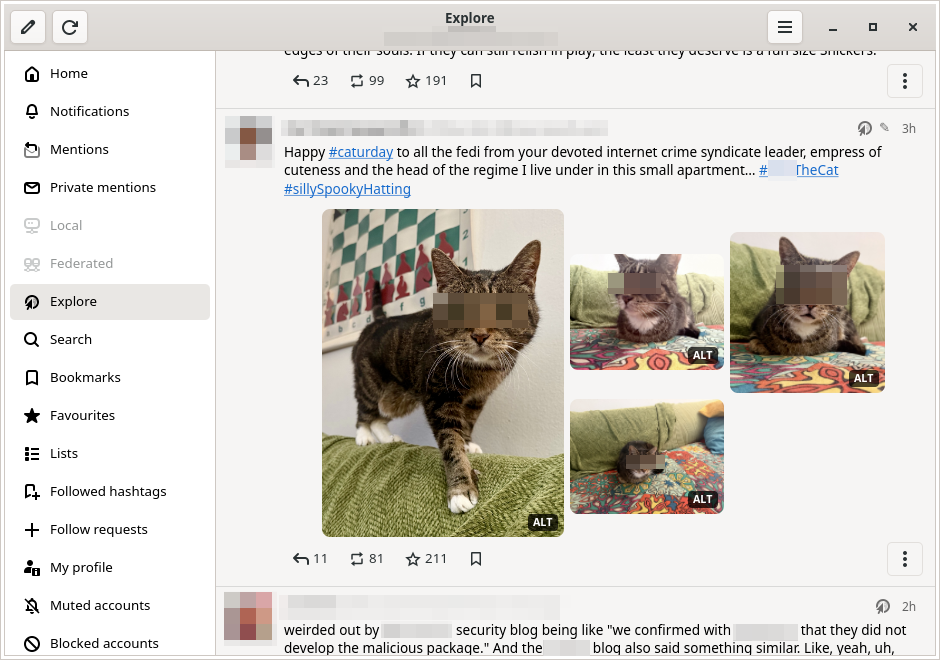
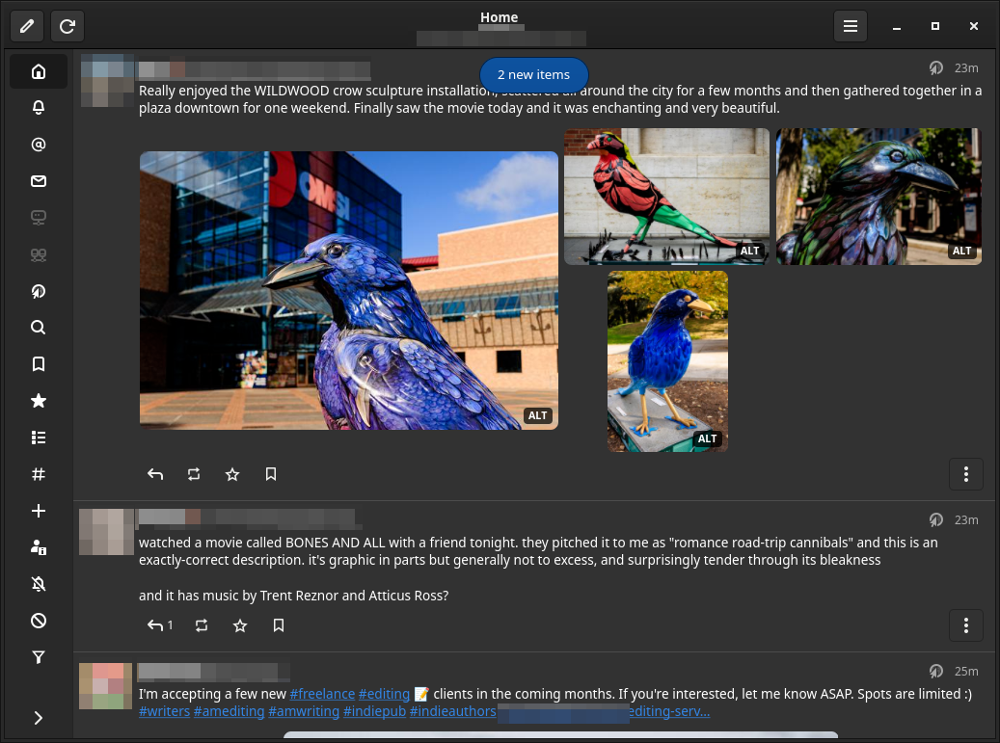

# FediGoo

A Mastodon client for the Linux desktop, written in Rust with GTK 4.

Created by [AI Sloperator](https://www.aisloperator.com/) with Claude Code.

No license is given.

## Features

- Multiple accounts, with OAuth login, switching and logout (which revokes the token),
  from the current account's avatar in the header bar
- Timelines: home, local, federated, hashtags, lists, trending posts, bookmarks and favorites
- Notifications, mentions and private conversations
- Live updates over the streaming API, with an unread badge and a "new items" button
- Posts: content warnings, sensitive-media covers, image viewer with alt text,
  link cards (right-click to open the link or copy it, also as Markdown), polls
  (with voting), threads with indented replies, translation; very long posts
  (over 600 characters) show only their start, with "Show more", except as the
  post a thread is opened on
- Actions: reply, boost, favorite, bookmark, edit, delete, delete & re-draft,
  pin, mute conversation, copy link or text, report
- Composer: character counter using the instance limit, content warning,
  visibility, language, media upload (file picker or paste) with alt text,
  polls, and Ctrl+Enter to send; if the server is slow or down, it shows that and
  you can cancel or try again without losing the post
- Profiles: bio, verified fields, follow or follow request, notify on new posts,
  hide boosts, mute, block, domain block, list membership, followers and following
- Search for accounts, hashtags and posts (URLs from other servers are resolved), with a
  selector like Explore's: All shows a few of each kind, and each kind has its own view
- Explore (trending posts, hashtags and news), follow requests, list management, mutes
  and blocks, profile editing (including avatar and header)
- Followed hashtags as a table sorted by name or by people posting recently (click a
  column title; again to reverse), opened with one click, with an unfollow button on
  each row (and follow again, until you leave the page)
- Keyword and hashtag filters: view, add, edit and delete them; matching posts are
  collapsed behind a warning or hidden, as each filter says
- Links to profiles, posts and hashtags on any server open inside the app
- The sidebar can shrink to icons only (the button at its foot), with labels as tooltips
- Zoom, as in a web browser (keys below, or Zoom in the main menu): 50% to 200% in fixed
  steps through 100%, remembered between runs. Text and everything sized from it
  scale; icons and avatars keep their size, and images in posts never get larger than
  at 100%

## Keyboard shortcuts

| Key               | Action      |
|-------------------|-------------|
| Ctrl+N            | New post    |
| F5 / Ctrl+R       | Refresh     |
| Alt+Left / Esc / Backspace | Back |
| Ctrl+F            | Search      |
| Ctrl+Enter        | Send post   |
| Ctrl+Q            | Quit        |
| Ctrl++ / Ctrl+=   | Zoom in     |
| Ctrl+−            | Zoom out    |
| Ctrl+0            | Actual size (100%) |
| PgDn / Space      | Page down   |
| PgUp / Shift+Space | Page up |

Paging lands on the start of a post where that doesn't skip anything, and
pages through posts taller than the window. Paging up twice at the top of a
feed checks for new posts; paging twice past either end of a thread checks
for new replies. Space and Backspace still type in text fields, and
Backspace does nothing on a top-level page (there's nothing to go back to).

In the image viewer:

| Key or gesture                         | Action          |
|----------------------------------------|-----------------|
| Right / Space, or click the image      | Next image      |
| Left / Backspace, or click its left 20% | Previous image |
| Swipe or drag left / right             | Next / previous |
| Esc / Ctrl+W                           | Close           |

## Building

System packages (Debian/Ubuntu names):

    sudo apt install pkgconf libgtk-4-dev libsoup-3.0-dev

Then, with a stable Rust toolchain from rustup:

    cargo build --release
    ./target/release/fedigoo

The only crate dependencies are the GTK bindings (`gtk4`) and the libsoup
bindings (`soup3`) plus their own dependencies. JSON handling and the HTML
conversion are built in. HTTPS uses libsoup and glib-networking.

## Running

    fedigoo            # GTK picks the backend (honors GDK_BACKEND)
    fedigoo --x11      # force X11
    fedigoo --wayland  # force Wayland

On X11 the window manager provides the title bar and the window buttons (or none,
as in tiling window managers), and FediGoo's header bar is a toolbar under it.
On GNOME-style desktops (GNOME, Pantheon, Budgie) and on Wayland, the header bar is
the title bar, with its own minimize, maximize and close buttons. `GTK_CSD=1`
asks for that anywhere.

## Installing

On Debian 13 (amd64), each [release](https://github.com/aisloperator/fedigoo/releases)
has a `.deb` package. Download it, then install it with:

    sudo apt install ./fedigoo_VERSION-1_amd64.deb

From a build of your own:

    ./target/release/fedigoo --install

This copies the executable to `~/.local/bin/fedigoo`, and adds a menu entry
(`~/.local/share/applications/com.aisloperator.FediGoo.desktop`) and an icon
(under `~/.local/share/icons/hicolor/`), so FediGoo shows up in your
application menu and dock. `fedigoo --uninstall` removes those files and
leaves your accounts and settings alone.

Log in through the welcome screen. FediGoo opens your instance's
authorization page in the browser; paste the code it shows back into
FediGoo.

All local data (accounts, access tokens, OAuth client registrations,
preferences) is in `$XDG_CONFIG_HOME/fedigoo/config.json`, normally
`~/.config/fedigoo/config.json`. The file is created with owner-only
permissions.

## Tests

    cargo test                   # offline unit tests
    cargo test -- --ignored      # also hits the public mastodon.social API

For testing the UI without a display, GTK's Broadway backend works, and
`tools/broadway-input.py` sends it real pointer and keyboard input (clicks,
drags, key shortcuts) in place of a web browser. Its docstring has the details.

## Code Dependencies

This section is updated before each release, from a build on the reference system:
Debian 13 (trixie) on amd64 (x86_64), using Debian's own packages for GTK 4, libsoup 3
and the other system libraries.

How much of it is specific to the reference system differs by list:

* **Direct crates** come from `Cargo.toml`, so they are the same everywhere.
* **Indirect crates** come from the committed `Cargo.lock`, listed for an x86_64 Linux
  build. A build from the same lock file uses the same crate versions on any system,
  though another target may build a slightly different set of crates. A `cargo update`
  can change the versions.
* **Non-crate libraries** (both lists) are what the reference system's release binary
  links to and loads. Another distribution, distribution version or architecture may have other
  library versions or sonames, link a different set, or load other modules at run time.

### Direct Crate Dependencies

These are the dependencies in `Cargo.toml`, with their version requirements.
`gtk4` is imported under the name `gtk`, and `soup3` under the name `soup`.

* [`gtk4`](https://crates.io/crates/gtk4) `0.11`
* [`soup3`](https://crates.io/crates/soup3) `0.9`

### Direct Non-Crate Dependencies

These are the system libraries that the release binary links to directly, as reported
by `objdump -p` on the reference system. Through the crate bindings, the app's code also
calls Pango and GDK, which are loaded as part of GTK. Building also needs the
`pkg-config` and `glib-compile-resources` tools and the GTK 4 and libsoup 3 development
files (Debian: `pkgconf libgtk-4-dev libsoup-3.0-dev`).

* libc (GNU C Library)
* libgcc_s
* libgio-2.0 (GIO)
* libglib-2.0 (GLib)
* libgobject-2.0 (GObject)
* libgraphene-1.0 (Graphene)
* libgtk-4 (GTK 4)
* libsoup-3.0 (libsoup 3)

### Indirect Crate Dependencies

These are every other crate in the build (normal and build-time dependencies) as
resolved in `Cargo.lock` for x86_64 Linux at the time of this update, from
`cargo tree -e normal,build`. Where a crate appears in more than one version, all
versions are listed. A later `cargo update` within the same `Cargo.toml` requirements
may resolve different versions, which might bring in different crates. Some of these
(such as `system-deps`, `pkg-config`, `syn` and `toml`) are used only while compiling
and are not part of the binary.

* [`autocfg`](https://crates.io/crates/autocfg) `1.5.1`
* [`bitflags`](https://crates.io/crates/bitflags) `2.13.2`
* [`cairo-rs`](https://crates.io/crates/cairo-rs) `0.22.9`
* [`cairo-sys-rs`](https://crates.io/crates/cairo-sys-rs) `0.22.9`
* [`cfg-expr`](https://crates.io/crates/cfg-expr) `0.20.10`
* [`equivalent`](https://crates.io/crates/equivalent) `1.0.3`
* [`field-offset`](https://crates.io/crates/field-offset) `0.3.6`
* [`futures-channel`](https://crates.io/crates/futures-channel) `0.3.34`
* [`futures-core`](https://crates.io/crates/futures-core) `0.3.34`
* [`futures-executor`](https://crates.io/crates/futures-executor) `0.3.34`
* [`futures-io`](https://crates.io/crates/futures-io) `0.3.34`
* [`futures-macro`](https://crates.io/crates/futures-macro) `0.3.34`
* [`futures-task`](https://crates.io/crates/futures-task) `0.3.34`
* [`futures-util`](https://crates.io/crates/futures-util) `0.3.34`
* [`gdk-pixbuf`](https://crates.io/crates/gdk-pixbuf) `0.22.0`
* [`gdk-pixbuf-sys`](https://crates.io/crates/gdk-pixbuf-sys) `0.22.9`
* [`gdk4`](https://crates.io/crates/gdk4) `0.11.5`
* [`gdk4-sys`](https://crates.io/crates/gdk4-sys) `0.11.5`
* [`gio`](https://crates.io/crates/gio) `0.22.10`
* [`gio-sys`](https://crates.io/crates/gio-sys) `0.22.9`
* [`glib`](https://crates.io/crates/glib) `0.22.10`
* [`glib-macros`](https://crates.io/crates/glib-macros) `0.22.9`
* [`glib-sys`](https://crates.io/crates/glib-sys) `0.22.9`
* [`gobject-sys`](https://crates.io/crates/gobject-sys) `0.22.9`
* [`graphene-rs`](https://crates.io/crates/graphene-rs) `0.22.8`
* [`graphene-sys`](https://crates.io/crates/graphene-sys) `0.22.9`
* [`gsk4`](https://crates.io/crates/gsk4) `0.11.5`
* [`gsk4-sys`](https://crates.io/crates/gsk4-sys) `0.11.5`
* [`gtk4-macros`](https://crates.io/crates/gtk4-macros) `0.11.5`
* [`gtk4-sys`](https://crates.io/crates/gtk4-sys) `0.11.5`
* [`hashbrown`](https://crates.io/crates/hashbrown) `0.17.1`
* [`heck`](https://crates.io/crates/heck) `0.5.0`
* [`indexmap`](https://crates.io/crates/indexmap) `2.14.2`
* [`libc`](https://crates.io/crates/libc) `0.2.191`
* [`memchr`](https://crates.io/crates/memchr) `2.8.3`
* [`memoffset`](https://crates.io/crates/memoffset) `0.9.1`
* [`pango`](https://crates.io/crates/pango) `0.22.9`
* [`pango-sys`](https://crates.io/crates/pango-sys) `0.22.9`
* [`pin-project-lite`](https://crates.io/crates/pin-project-lite) `0.2.17`
* [`pkg-config`](https://crates.io/crates/pkg-config) `0.3.34`
* [`proc-macro-crate`](https://crates.io/crates/proc-macro-crate) `3.5.0`
* [`proc-macro2`](https://crates.io/crates/proc-macro2) `1.0.107`
* [`quote`](https://crates.io/crates/quote) `1.0.47`
* [`rustc_version`](https://crates.io/crates/rustc_version) `0.4.1`
* [`semver`](https://crates.io/crates/semver) `1.0.28`
* [`serde_spanned`](https://crates.io/crates/serde_spanned) `1.1.2`
* [`slab`](https://crates.io/crates/slab) `0.4.12`
* [`smallvec`](https://crates.io/crates/smallvec) `1.16.4`
* [`soup3-sys`](https://crates.io/crates/soup3-sys) `0.9.0`
* [`syn`](https://crates.io/crates/syn) `3.0.9`
* [`system-deps`](https://crates.io/crates/system-deps) `7.0.8`, `9.0.1`
* [`target-lexicon`](https://crates.io/crates/target-lexicon) `0.13.5`
* [`toml`](https://crates.io/crates/toml) `1.1.8+spec-1.1.0`
* [`toml_datetime`](https://crates.io/crates/toml_datetime) `1.1.2+spec-1.1.0`
* [`toml_edit`](https://crates.io/crates/toml_edit) `0.25.17+spec-1.1.0`
* [`toml_parser`](https://crates.io/crates/toml_parser) `1.1.5+spec-1.1.0`
* [`unicode-ident`](https://crates.io/crates/unicode-ident) `1.0.27`
* [`version-compare`](https://crates.io/crates/version-compare) `0.2.1`
* [`winnow`](https://crates.io/crates/winnow) `1.0.4`

### Indirect Non-Crate Dependencies

These are the libraries loaded because of the direct ones above, as reported by `ldd`
for the release binary on the reference system, plus modules that GLib and GTK load at run
time, which `ldd` doesn't show. The exact set depends on how the distribution
built GTK, GLib and libsoup, and on the desktop, so other systems may differ.

* libatomic
* libblkid
* libbrotlicommon
* libbrotlidec
* libbz2
* libcairo
* libcairo-gobject
* libcairo-script-interpreter
* libcloudproviders
* libcom_err
* libdatrie
* libdconfsettings (dconf GSettings backend, loaded at run time)
* libdeflate
* libEGL, libGL and Mesa or other OpenGL/Vulkan drivers (loaded at run time by libepoxy and libvulkan)
* libepoxy
* libexpat
* libffi
* libfontconfig
* libfreetype
* libfribidi
* libgdk_pixbuf-2.0
* libgiognutls (glib-networking TLS module, loaded at run time)
* libgmodule-2.0
* libgnutls (GnuTLS, used by libgiognutls)
* libgraphite2
* libgssapi_krb5
* libharfbuzz
* libharfbuzz-subset
* libidn2
* libjbig
* libjpeg
* libk5crypto
* libkeyutils
* libkrb5
* libkrb5support
* libLerc
* liblzma
* liblzo2
* libm
* libmount
* libnghttp2
* libpango-1.0
* libpangocairo-1.0
* libpangoft2-1.0
* libpcre2-8
* libpixbufloader_svg and other gdk-pixbuf image loaders, with librsvg (loaded at run time)
* libpixman-1
* libpng16
* libpsl
* libresolv
* libselinux
* libsharpyuv
* libsqlite3
* libstdc++
* libthai
* libtiff
* libunistring
* libvulkan
* libwayland-client
* libwayland-egl
* libwebp
* libX11
* libXau
* libxcb
* libxcb-render
* libxcb-shm
* libXcursor
* libXdamage
* libXdmcp
* libXext
* libXfixes
* libXi
* libXinerama
* libxkbcommon
* libXrandr
* libXrender
* libz
* libzstd
